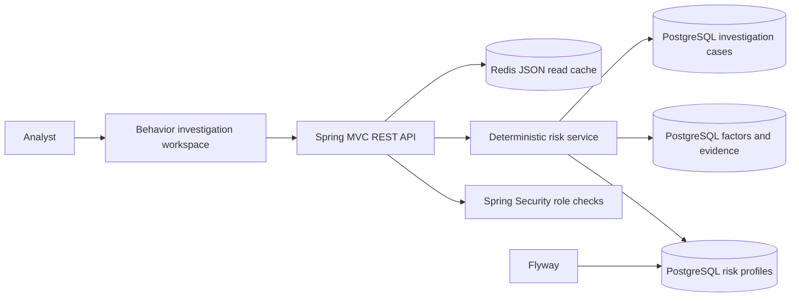
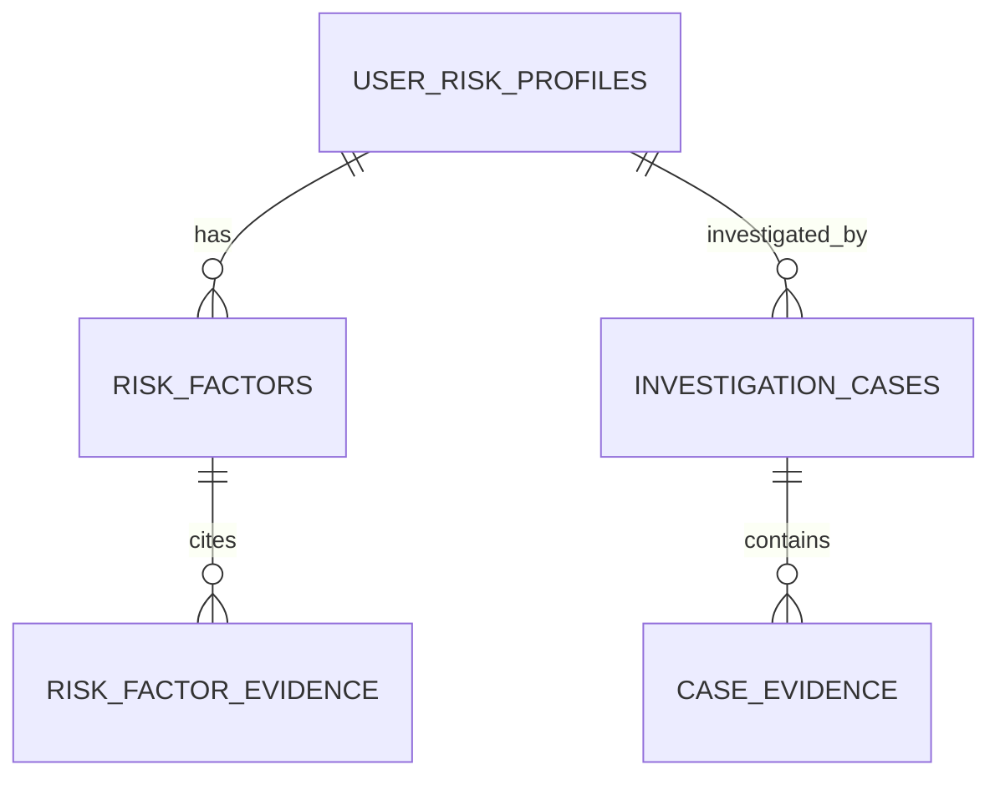

# BehaviorGuard

BehaviorGuard is an independently deployable defensive UEBA application focused on explainable risk scoring, synthetic behavior baselines, and analyst investigation. Its account-takeover scenario shows how identity, device, timing, travel, and threat context contribute to a risk change.

## Product Design

The investigation workspace places the risk leaderboard beside a selected identity's baseline and factor breakdown, with open cases below. Analysts can inspect what changed, read the evidence for each factor, and trigger a deterministic demo scenario. The score is produced by Java code; AI does not assign or change risk.

## Technical Features

- Java 21, Spring Boot 3.5, Maven Wrapper 3.9.9.
- PostgreSQL with a separate `behaviorguard` database and `behaviorguard_app` owner role.
- Flyway migrations for profiles, risk factors, factor evidence, cases, and case evidence.
- Transactional profile/factor/case writes and database constraints for score bounds and evidence ordering.
- Password-protected Redis JSON caches for leaderboard and case reads, with a 30-second TTL.
- Spring Security HTTP Basic roles: `ADMIN`, `ANALYST`, and `VIEWER`.
- Analyst-only scenario execution; viewers have read-only APIs.
- Actuator health, Prometheus metrics, non-root Docker image, local Compose stack, CI, Dependabot, and Testcontainers integration coverage.

## Architecture





A profile stores the baseline and current risk score. Each factor stores its points, explanation, and evidence references; each case stores a separate evidence timeline.

## Run With Docker

Requirements: Docker Desktop with the Linux container engine enabled. From this repository's root:

```powershell
Copy-Item .env.example .env
docker compose up --build
```

Open [http://localhost:8082](http://localhost:8082). This project runs independently with its own PostgreSQL and Redis containers. Their loopback developer ports are `5434` and `6382`. Run `docker compose down` to stop while retaining named volumes; `docker compose down -v` removes local data.

## Build, Test, And Run Locally

Requirements: JDK 21. Start only this repository's database and cache:

```powershell
Copy-Item .env.example .env
docker compose up -d postgres redis
```

From the project root, run verification:

```powershell
& (Join-Path $PWD 'mvnw.cmd') --batch-mode clean verify
```

Start the app in its own terminal:

```powershell
& (Join-Path $PWD 'mvnw.cmd') spring-boot:run
```

Build and run the executable JAR:

```powershell
& (Join-Path $PWD 'mvnw.cmd') clean package
java -jar target/behaviorguard-0.1.0.jar
```

## Local Accounts And API

Default local-only accounts (override passwords in `.env`):

| Role | Username | Default password | Permissions |
| --- | --- | --- | --- |
| Admin | `admin` | `local-admin-change-me` | Read, run scenario, Prometheus |
| Analyst | `analyst` | `local-analyst-change-me` | Read and run scenario |
| Viewer | `viewer` | `local-viewer-change-me` | Read-only |

The app connects as `behaviorguard_app`, which owns only this project's database. The default local role password is `local-behaviorguard-change-me`. Dashboard credentials stay in tab-scoped session storage.

```powershell
curl.exe -u viewer:local-viewer-change-me http://localhost:8082/api/v1/users/risk
```

| Method | Endpoint | Role |
| --- | --- | --- |
| `GET` | `/api/v1/users/risk` | Viewer or higher |
| `GET` | `/api/v1/cases` | Viewer or higher |
| `POST` | `/api/v1/demo/account-takeover` | Analyst or admin |
| `GET` | `/actuator/health` | Public health status |
| `GET` | `/actuator/prometheus` | Admin |

## CI And Safety

`.github/workflows/ci.yml` runs Maven Wrapper verification and builds this repository's Docker image. `.github/dependabot.yml` tracks Maven, Docker, and Actions updates. See [SECURITY.md](SECURITY.md) for reporting and deployment guidance.

This is a local portfolio system, not a production UEBA product. Identities and events are fictional. Demo HTTP Basic accounts are in-memory and should be replaced by OIDC-backed identity for real deployments; do not expose this service to an untrusted network.
